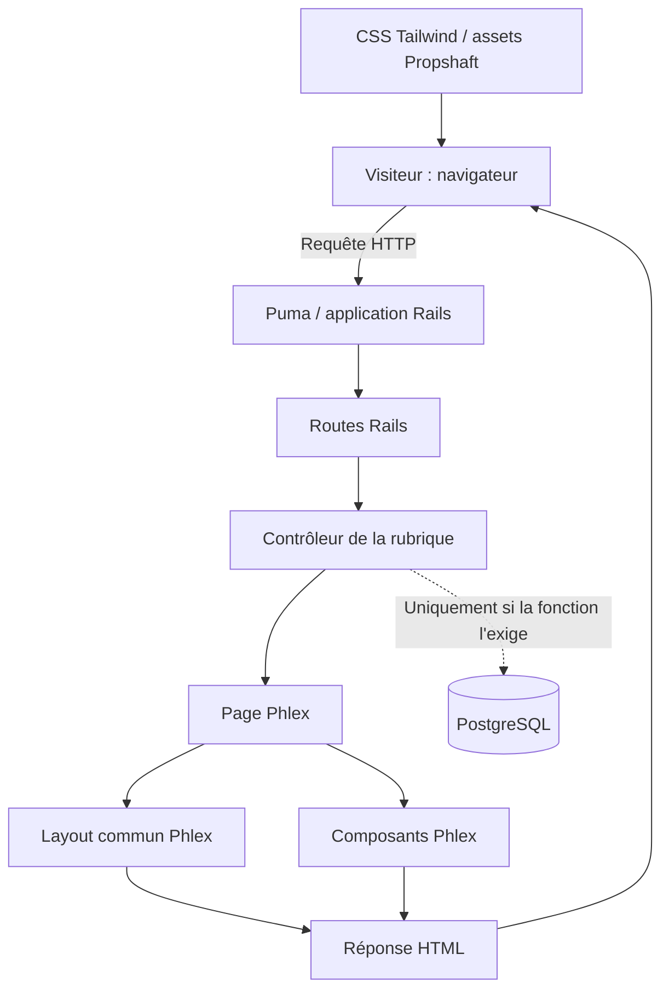

# NEXSPRO — Architecture du système

**Document :** `docs/04-system-architecture.md`  
**Statut :** référence d'architecture du projet  
**Version :** 1.0  
**Dernière mise à jour :** 2 novembre 2026  
**Responsable :** propriétaire de NEXSPRO  
**Périmètre :** organisation technique constatée, flux applicatifs, environnement et frontières de l'architecture V1

## 1. Objet et portée

Ce document décrit **comment NEXSPRO est organisé et comment sa V1 fonctionne techniquement**. Il complète la [définition du projet](01-project-definition.md), la [vision produit](02-product-vision.md) et le [périmètre fonctionnel V1](03-functional-scope.md), sans en reprendre les exigences page par page.

L'architecture retenue est celle d'une **application web Rails unique, avec rendu HTML côté serveur**, organisée selon les responsabilités des composants. Le développement actuel est individuel ; NEXSPRO n'a pas vocation à être distribué comme un produit logiciel générique.

La qualification de **monolithe Rails évolutif** décrit le système constaté et la direction retenue. « Modulaire » signifie ici *responsabilités séparées dans une seule application*, et non la présence démontrée de moteurs Rails, de packages indépendants ou d'une architecture microservices.

### Règles de vérité

- **Constaté** : contenu ou arborescence réellement visible dans les sources publiques consultées.
- **Décidé** : orientation explicitement fixée par le propriétaire de NEXSPRO.
- **À vérifier** : comportement, version ou configuration dont la preuve n'a pas pu être établie de manière fiable.
- **Recommandé** : bonne pratique à appliquer lors des changements, sans la présenter comme déjà implémentée.

**Limite de la vérification du 02/11/2026 :** inspection en lecture seule de pages de la branche publique `main`, parfois mises en cache ; aucun SHA de commit récent n'a pu être garanti. L'accès à plusieurs fichiers bruts a échoué. Aucun clonage, lancement de l'application, test, audit de production ou déploiement n'a été réalisé pendant cette rédaction. Les observations factuelles ci-dessous correspondent aux fichiers consultables, **pas nécessairement à l'état le plus récent du clone local**. L'édition 1.0 constitue une référence utilisable et évolutive, non une certification d'audit exhaustif.

## 2. Vue d'ensemble



**Lecture :** une route dirige la requête vers un contrôleur ; l'action rend une classe de page Phlex ; celle-ci utilise des composants et le layout commun pour produire le HTML. Les ressources CSS et images sont servies séparément au navigateur. PostgreSQL appartient à la fondation applicative, mais **aucun accès à la base n'est présumé pour l'affichage des pages statiques**.

Ce diagramme décrit le chemin de rendu principal et non les détails internes complets de Rack, des middlewares Rails, des caches ou de la livraison des assets.

## 3. Technologies et responsabilités

| Élément | Choix retenu / présent | Responsabilité | Source d'autorité |
| --- | --- | --- | --- |
| Ruby | Langage de référence | Logique applicative et composants d'interface | `.ruby-version`, `Gemfile` |
| Ruby on Rails 8 | Framework web principal | Routage, contrôleurs, configuration, conventions | `Gemfile.lock`, `config/` |
| Puma | Serveur d'application | Traitement des requêtes Rails | `Gemfile`, `config/puma.rb` |
| Phlex / Phlex Rails | Couche de rendu principale | Pages, layouts et composants HTML en Ruby | `app/views/`, `Gemfile` |
| Tailwind CSS | Styles | Classes utilitaires, thème et styles spécifiques | `app/assets/tailwind/application.css` |
| Propshaft | Assets Rails | Mise à disposition des ressources statiques | `Gemfile`, configuration Rails |
| PostgreSQL | Base de données de référence | Persistance si et quand les fonctions l'utilisent | `config/database.yml`, `compose.yaml` |
| Docker / Compose | Environnement conteneurisé | Construction et orchestration locale | `Dockerfile`, `compose.yaml` |
| RSpec | Tests automatisés | Vérification des comportements | `spec/`, `.rspec` |
| RuboCop, Brakeman, Bundler Audit | Outils de qualité et de sécurité | Analyses du code et des dépendances | `Gemfile`, scripts CI |
| Git / GitHub Actions | Versionnement et CI | Traçabilité et automatisation | `.github/workflows/ci.yml` |

Les **versions exactes** doivent être lues dans le commit réellement audité, notamment `Gemfile.lock` et `.ruby-version`. Les pages consultées ne constituent pas une preuve d'installation locale ou de compatibilité de tous les outils. Aucun framework JavaScript d'application distinct n'est requis par l'architecture décidée ; cela **n'interdit pas un JavaScript ponctuel justifié**.

## 4. Organisation du dépôt

Arborescence **simplifiée** observée dans le dépôt public :

```text
nexspro/
├── .devcontainer/             # Configuration d'environnement de développement
├── .github/                   # CI et automatisations GitHub
├── app/
│   ├── assets/                # Images, CSS, Tailwind et builds
│   ├── controllers/           # Contrôleurs des rubriques
│   ├── helpers/
│   ├── jobs/
│   ├── mailers/
│   ├── models/
│   └── views/
│       ├── base.rb            # Base commune des pages Phlex
│       ├── components/        # Composants d'interface
│       ├── layouts/           # Layout général
│       ├── pages/             # Pages organisées par rubrique
│       └── pwa/               # Fichiers de présentation PWA
├── bin/                       # Exécutables et scripts du projet
├── config/                    # Routes, environnements, initialisation, services
├── db/                        # Schémas et données d'initialisation
├── docs/                      # Documentation de référence
├── lib/tasks/                 # Tâches Rake personnalisées, si définies
├── public/                    # Ressources publiques
├── spec/                      # Tests RSpec
├── Dockerfile
├── compose.yaml
├── Gemfile
├── Gemfile.lock
├── Procfile.dev
└── README.md
```

Il s'agit d'une **carte des responsabilités**, pas d'un relevé exhaustif de chaque fichier. L'existence d'un dossier Rails standard (`models/`, `jobs/`, `mailers/`) **ne prouve pas** qu'une fonctionnalité métier exploite ce dossier.

### Responsabilités principales

| Chemin | Responsabilité | Précision |
| --- | --- | --- |
| `config/routes.rb` | Déclarer les points d'entrée HTTP et leurs actions | Routes V1 effectivement déclarées. |
| `app/controllers/*_controller.rb` | Recevoir les requêtes et sélectionner les pages | Contrôleurs `Home`, `Studio`, `Streaming`, `Gaming`, `Library`, `Connect` observés. |
| `app/views/pages/<univers>/` | Rendre les pages métier et leur contenu | Arborescence des six univers observée. |
| `app/views/components/` | Regrouper des éléments visuels composables | Sous-dossiers `navigation`, `home`, `studio`, `shared`, `theme`, `footer` observés. |
| `app/views/base.rb` | Fournir une base de page et intégrer le layout | Classe `Views::Base` observée. |
| `app/views/layouts/application_layout.rb` | Générer la structure HTML partagée | Métadonnées, CSS, navigation, lien d'évitement, zone principale observés. |
| `app/assets/tailwind/application.css` | Définir les styles Tailwind et les tokens du thème | `@theme`, Inter et accent `#58e1d4` observés. |
| `config/` | Paramétrer Rails, DB et services techniques | Tout usage réel d'une configuration exige sa lecture et, si nécessaire, son exécution. |
| `spec/requests/` | Vérifier les réponses HTTP et des exigences transversales | `site_pages_spec.rb`, `accessibility_spec.rb`, `pwa_manifest_spec.rb` visibles ; résultats non vérifiés. |
| `.github/workflows/ci.yml` | Décrire les contrôles CI | Fichier présent ; succès des derniers jobs non attesté. |

## 5. Routage et rendu de la V1

`config/routes.rb` déclare l'accueil et les pages des cinq autres univers : **15 routes de pages au total** (1 accueil, 3 Studio, 3 Streaming, 3 Gaming, 3 Library, 2 Connect). Il déclare aussi le point de santé `/up` et des routes PWA. La liste des parcours attendus est la responsabilité de [`03-functional-scope.md`](03-functional-scope.md).

### Exemple de flux confirmé : accueil

1. `root "home#index"` dirige `/` vers `HomeController#index`.
2. `HomeController#index` exécute `render Views::Pages::Home::Index.new`.
3. `Views::Pages::Home::Index` hérite de `Views::Base`.
4. `Views::Base#around_template` encadre le rendu avec `Views::Layouts::ApplicationLayout`.
5. La page compose des composants Phlex, par exemple `Home::Hero`, `Home::StudioSection` et `Home::StreamingSection`.
6. Le layout produit le document HTML, inclut la feuille `tailwind`, la navigation et la zone `main`.

**Conséquence d'architecture :** pour ajouter une page simple, la solution de référence est de travailler dans les routes, le contrôleur correspondant, la page Phlex et, selon le besoin, les composants existants. Il n'est pas nécessaire d'introduire un nouveau service ou un frontend séparé pour cette opération.

## 6. Présentation, composants et assets

Le rendu HTML est **généré côté serveur**. Les pages sont organisées par univers et les composants communs sont factorisés dans `app/views/components/` lorsqu'ils répondent à un besoin réel.

Le layout observé déclare notamment : `html lang: "en"`, un titre fourni par la page, les métadonnées CSRF/CSP, des icônes, `stylesheet_link_tag "tailwind"`, un lien d'accès direct au contenu et une barre de navigation. La valeur de `lang` devra toujours correspondre à la langue effective du contenu ; **elle n'est pas automatiquement correcte pour toutes les futures pages**.

La feuille Tailwind utilise `@import "tailwindcss"`, une variante `dark` et un thème avec la police **Inter** et un accent **`#58e1d4`**. Les styles de base et les composants existants doivent être privilégiés avant de multiplier les variantes locales.

Les routes PWA sont présentes. Le layout consulté fait référence à `/manifest.json`, tandis que `config/routes.rb` déclare aussi `manifest` et `service-worker` via les contrôleurs Rails PWA : **vérifier les URL réellement servies** avant d'affirmer qu'une fonctionnalité PWA complète est opérationnelle.

## 7. Configuration, environnement et base de données

Le dépôt contient `Dockerfile`, `compose.yaml`, `config/database.yml`, `config/puma.rb`, `config/cache.yml`, `config/queue.yml`, `config/cable.yml` et `config/storage.yml`. La configuration Compose précédemment inspectée dans cette conversation comprenait un service applicatif Rails et un service PostgreSQL, avec transmission de la connexion de base via l'environnement.

**Frontières à maintenir :**

- **Développement local :** peut utiliser Docker Compose et des identifiants dédiés au développement ; ne pas recopier ces valeurs comme secrets de production.
- **Test :** isoler les données et les paramètres du reste du système ; les scripts CI observés provisionnent PostgreSQL pour les vérifications.
- **Production :** configuration, hébergement, secrets, persistance, sauvegardes et procédure de déploiement **non attestés par cet audit**. Ne pas transformer la configuration de développement en spécification de production.

Le dépôt contient également les schémas `db/cache_schema.rb`, `db/queue_schema.rb`, `db/cable_schema.rb`, compatibles avec l'usage prévu de Solid Cache, Solid Queue et Solid Cable. Leur présence **n'implique pas** qu'ils soient indispensables au rendu actuel des pages statiques. La décision de les conserver, configurer ou retirer dépend d'un audit de leurs usages effectifs et de l'impact sur Rails.

## 8. Sécurité et limites de confiance

Pour la V1 publique, la principale frontière est **navigateur ↔ application Rails**. La présence éventuelle de liens vers des services externes ne les rend pas internes à NEXSPRO.

Les points suivants structurent l'architecture sans présumer de leur conformité actuelle :

- Ne jamais placer d'identifiants de base, de clés, de tokens ou de credentials déchiffrés dans Git, les assets publics ou les documents.
- Conserver les protections Rails pertinentes (CSRF, CSP, paramètres sûrs) ; toute modification doit être examinée, pas désactivée par commodité.
- Vérifier les réponses publiques, les métadonnées, la langue HTML, le comportement des liens et l'absence de contenu privé exposé.
- Évaluer les dépendances, les en-têtes HTTP et les variables d'environnement **sur la configuration effectivement déployée**, avant la mise en ligne.
- Ne pas introduire une authentification, des données personnelles persistées, des uploads ou des paiements tant qu'une fonctionnalité approuvée ne le nécessite pas.

Les règles de mise en œuvre et les contrôles détaillés appartiennent à `05-engineering-standards.md`.

## 9. Tests, qualité et intégration continue

La structure `spec/` inclut des tests de requêtes HTTP, d'accessibilité et de manifeste PWA. La configuration CI GitHub Actions inclut un fichier `.github/workflows/ci.yml` avec, entre autres, préparation des assets, environnement PostgreSQL, exécution de `bin/ci` et des vérifications de disponibilité HTTP.

**Interprétation correcte :** l'existence de fichiers de tests et d'un workflow ne signifie ni que les tests passent, ni que l'ensemble des pages est couvert, ni qu'une CI a été exécutée avec succès pour le commit local actuel.

Le document [`03-functional-scope.md`](03-functional-scope.md) fixe les conditions de mise en ligne `V1-01` à `V1-09`. `05-engineering-standards.md` précisera les commandes, les normes et les pratiques de vérification, plutôt que de les dupliquer ici.

## 10. Décisions d'architecture et frontières d'évolution

### Retenu pour la V1

- Une application Rails unique avec pages publiques majoritairement statiques.
- Contrôleurs légers et pages Phlex rendues côté serveur.
- Layout commun, composants réutilisables et styles Tailwind.
- Une base PostgreSQL dans la fondation existante, sans obligation d'y stocker les contenus statiques.
- Développement et tests outillés, avec possibilité d'environnement Docker.

### Non imposé pour la V1

- Microservices, déploiement multi-applications ou API publique séparée.
- Frontend SPA ou framework JavaScript structurel.
- Comptes, communauté interne, système de paiement, CMS complexe, temps réel ou streaming natif.
- Découpage anticipé en moteurs Rails, systèmes de plugins ou couches métier abstraites sans besoin prouvé.

**Principe d'évolution :** une fonctionnalité approuvée doit d'abord pouvoir s'intégrer à l'application Rails existante. Une nouvelle dépendance, un nouveau stockage ou une nouvelle séparation de service nécessite une justification documentée dans `06-technical-decisions.md` : besoin, solutions comparées, bénéfices, coût de maintenance, sécurité et possibilité de retour arrière.

## 11. Vérifications reproductibles à effectuer sur le dépôt de travail

Ces opérations sont **proposées, non exécutées**. Elles permettent d'actualiser la présente référence sur un commit identifiable :

```bash
# Lecture seule : identité du code audité
git rev-parse HEAD
git status --short

# Lecture seule : fichiers et dépendances déclarées
cat .ruby-version
sed -n '1,180p' Gemfile
sed -n '1,200p' config/routes.rb

# Nécessite l'environnement Ruby/Bundler du projet
bundle exec rails routes
bundle exec rails zeitwerk:check

# Vérification de la configuration Docker, sans démarrer les services
# Attention : la sortie peut révéler des valeurs d'environnement sensibles.
docker compose config --quiet
```

Les tests RSpec, les builds d'assets et le démarrage de Docker pourront ensuite être exécutés volontairement dans un environnement adapté ; **ils ne sont pas assimilés à des lectures sans effet**, car ils peuvent créer des fichiers, des conteneurs ou modifier une base de test.

Points nécessitant une confirmation spécifique avant de documenter une production réelle : versions exactes et SHA, environnement actif, connexions et schémas de base, usage des services Solid, statut des workflows, URLs PWA, méthode de déploiement, secrets, sauvegardes et résultats des tests V1.

## 12. Sources de référence et maintenance

### Fichiers du dépôt consultés ou repérés

- [Arborescence générale](https://github.com/nexsura/nexspro)
- [Routage Rails](https://github.com/nexsura/nexspro/blob/main/config/routes.rb)
- [Contrôleur d'accueil](https://github.com/nexsura/nexspro/blob/main/app/controllers/home_controller.rb)
- [Page d'accueil Phlex](https://github.com/nexsura/nexspro/blob/main/app/views/pages/home/index.rb)
- [Base des pages Phlex](https://github.com/nexsura/nexspro/blob/main/app/views/base.rb)
- [Layout principal](https://github.com/nexsura/nexspro/blob/main/app/views/layouts/application_layout.rb)
- [Composants d'interface](https://github.com/nexsura/nexspro/tree/main/app/views/components)
- [Thème Tailwind](https://github.com/nexsura/nexspro/blob/main/app/assets/tailwind/application.css)
- [Tests de requêtes](https://github.com/nexsura/nexspro/tree/main/spec/requests)
- [Workflow CI](https://github.com/nexsura/nexspro/blob/main/.github/workflows/ci.yml)
- [Configuration Rails](https://github.com/nexsura/nexspro/tree/main/config)

### Documentations officielles pour l'évolution

- [Ruby on Rails Guides](https://guides.rubyonrails.org/)
- [Phlex — documentation](https://www.phlex.fun/)
- [Tailwind CSS](https://tailwindcss.com/docs)
- [Docker Compose](https://docs.docker.com/compose/)
- [GitHub Actions](https://docs.github.com/en/actions)
- [RSpec Rails](https://rspec.info/)

### Règles de maintenance

1. Cette version est la **référence d'architecture V1.0**, et non un brouillon jetable ; elle peut être révisée quand l'implémentation réelle change.
2. Une modification structurelle avérée (rendu, persistance, infrastructure, composants structurants, déploiement) nécessite une mise à jour de la présente référence et, si elle implique un arbitrage, de `06-technical-decisions.md`.
3. Un changement de périmètre produit relève d'abord de `03-functional-scope.md`, pas de ce fichier.
4. Toute révision fondée sur un nouvel audit doit indiquer le **SHA du commit** et distinguer ce qui a été lu, exécuté et démontré ; les points non vérifiés restent explicitement identifiés.
5. Ce document n'autorise à lui seul aucune modification, suppression, migration ou mise en production.

**Historique documentaire**

| Version | Date | Changement |
| --- | --- | --- |
| 1.0 | 2026-11-02 | Établissement de la référence d'architecture de NEXSPRO à partir de l'inspection partielle du dépôt public et des décisions confirmées du projet. |
